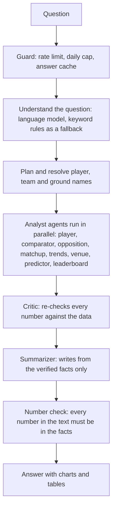

# Smart Cricket

An IPL analytics app: player profiles, comparisons, career timelines, batter-against-bowler matchups, leaderboards, match predictions, and an AI assistant that answers questions in plain English. It covers every IPL match from 2008 to 2025 (1,169 matches, 278,034 deliveries).

**Live app:** PASTE YOUR APP LINK HERE

## What you can do

| Page | What it shows |
|---|---|
| Player profile | Career numbers, season charts, phase splits (powerplay, middle, death), strengths and weaknesses, home and away |
| Compare | Two to four players side by side, with a scorecard, a radar chart and era-adjusted measures |
| Career timeline | The ups and downs of a career: peak and slump seasons, form over the last 10 innings, team changes |
| Leaderboards | Top players by any statistic, filtered by season, team, opponent and ground |
| Matchups | A batter against a bowler, a player against a team, a player at a ground |
| Match predictor | The chase win chance after the first innings, a live win chance during the chase, and a match preview |
| Ask | Type a question in your own words |

## How the AI assistant works



- **The language model never calculates a number.** It reads the question and writes the summary. Every figure comes from a tested analytics engine over 15 tables.
- **The Critic re-checks the results** before any text is written: season, phase and opponent totals must add back to the career totals, rankings must be sorted, probabilities must add to 1. A result that fails a check is dropped.
- **The summarizer is checked too.** If its text contains a number that is not in the verified facts, it gets one retry, and then the verified tables are shown instead of the text.
- **If the model is busy or slow**, the app says so and shows the same verified numbers, and the dashboard pages always work. Several API keys and two models are tried in turn, with a time limit.
- **Safeguards:** a per-visitor rate limit, a daily cap shared by all visitors, and a cache of repeated questions.

## Accuracy and limits

- **After the first innings:** the chasing team's result is predicted from the first-innings score compared with the ground's par score. Tested by walking forward season by season (2015 to 2025, 691 matches), it was right about 68% of the time (give or take 3.5 points), against 53% for always backing the chasing team.
- **During the chase:** the win chance uses the runs needed, balls left and wickets in hand. Tested the same way, it was right about 70% of the time after 3 overs, 78% after 10 and 87% after 18. When it gave the chasing team 10 to 40%, chasing teams won about 4 points more often than predicted.
- **Before the match:** team ratings, home advantage and the toss added no measurable accuracy when tested, so the match preview shows facts and sample sizes and no win probability.
- **Data** runs to the end of IPL 2025. There is no 2026 data yet.
- **The consistency index** is a custom measure: the share of innings with a useful contribution, balanced against the share of low scores. Read it next to the average and strike rate.
- Predictions are model estimates, not betting advice.

## Project structure

```
app/        Streamlit pages and chart code
agents/     question understanding, analyst agents, LangGraph flow, critic, summarizer, safeguards
core/       the analytics engine: name matching, career, season, phase, matchup, venue, trends, compare, leaderboard, predictors
pipeline/   build_tables.py (raw match files to 15 tables), train_predictor.py, train_live.py
data/processed/   the 15 Parquet tables
models/     the two saved prediction models and their accuracy reports
config/     home grounds by team and season
tests/      automated tests
notebooks/  exploration
```

## Run it locally

```
pip install -r requirements.txt
streamlit run app/Home.py
```

For the Ask page, create a `.env` file (it is not committed) with `GOOGLE_API_KEY_1=...`, and optionally `_2` and `_3`. On Streamlit Community Cloud, put the same names in the app's secrets. Without keys, the Ask page still shows the verified numbers and says the assistant is not set up.

To rebuild the tables from the raw match files, put them in `data/raw/ipl_json` and run `python pipeline/build_tables.py`. Re-train the models with `python pipeline/train_predictor.py` and `python pipeline/train_live.py`.

## Tests

Each file in `tests/` that starts with `test_` runs on its own and ends with `failures: 0`. None of them needs an API key. On Windows, run them all with:

```
for %f in (tests\test_*.py) do @python %f
```

`tests/eval_*.py` and `tests/diag_*.py` call the real language model and need keys.

## Data

Ball-by-ball IPL match files (one JSON file per match), 2008 to 2025. ADD THE SOURCE NAME, LINK AND LICENCE FROM THE PAGE YOU DOWNLOADED THEM FROM. The raw files are not in this repository.

## Next

- A second version of the predictor that rates teams from their playing XI.
- IPL 2026 data.
- Show the verified numbers immediately and add the written text when it arrives.
